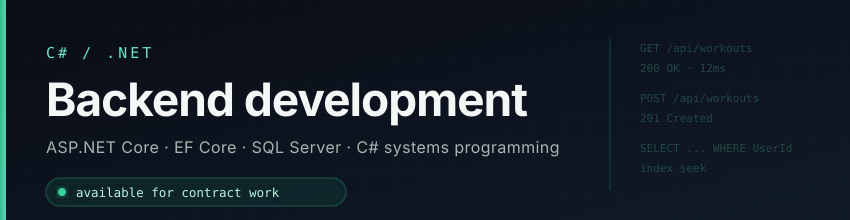

  

  
  &nbsp;
  

# C# / .NET backend developer

I build and fix .NET backends. I'm based in Bulgaria and available for small,
well-defined contract work: the kind of task where the scope can be written
down, delivered, and verified.

## What I can help with

- **ASP.NET Core API slices** — Identity auth, EF Core + SQL Server schema and
  migrations, controllers/services/DTOs, ownership checks, paging, OpenAPI.
- **Bug fixing and backend maintenance** — reproduce the issue, fix it, add a
  regression test, and document what changed.
- **API integrations** — typed `HttpClient`, retries and timeouts, webhook
  handling, and contract tests between services.
- **C# performance audits** — BenchmarkDotNet harness, baseline measurements,
  one to three low-risk optimizations, and a written report with caveats.
- **Embeddable scripting VMs** — a small numeric scripting layer built on
  [Raptor](https://github.com/InfiniteFightingGhost/Raptor).

Engagements start at **€150**; small fixed-scope work is typically **€25/hour**.
I quote fixed prices only after the scope and acceptance criteria are clear.

## Selected work

### Raptor — register-based VM and scripting language

[Raptor](https://github.com/InfiniteFightingGhost/Raptor) is a public,
MIT-licensed virtual machine and scripting pipeline written from scratch in
unsafe C#. I built the compiler, assembler, bytecode verifier, FFI host binding,
CLI, tests, benchmarks, and CI.

- Register-based VM with pinned memory, raw pointers, a custom heap, and RISC-V-style sliding register windows.
- RaptorScript compiler: lexer, parser, AST, code generation, source maps.
- Bytecode verifier, disassembler, hot reload, and debug/profile run modes.
- 159 xUnit test methods, cross-platform CI, NativeAOT smoke test, and a NuGet preview.
- [Source](https://github.com/InfiniteFightingGhost/Raptor) ·
  [NuGet](https://www.nuget.org/packages/Raptor.VM) ·
  [Architecture docs](https://github.com/InfiniteFightingGhost/Raptor/blob/main/docs/architecture.md)

Raptor is an R&D preview, not production-proven software. The benchmark numbers
in the repo come from my hardware and are sensitive to allocation layout; I
don't present them as independent or universal results. The sliding-window call
model also has a known recursion-depth limit. I can re-read the VM internals
before a deep technical walkthrough.

### WorkoutTracker — C# backend (private)

A multi-user strength-training API. I designed the database schema and data
models and wrote most of the service layer. Controllers, DTOs, Identity wiring,
the React frontend, the Python analytics service, the later analytics
integration, and the test suite were completed with AI agents under my
direction.

- ASP.NET Core controllers and services with per-user ownership checks.
- EF Core + SQL Server: 17-entity schema, 29 migrations, check constraints,
  filtered indexes, and paging with `AsNoTracking` / `AsSplitQuery`.
- ASP.NET Core Identity bearer auth, DTO-based API surface, and Swagger.
- Workout, template, exercise, personal-record, and measurement workflows,
  including e1RM, INOL, and PR upsert logic.
- Service boundaries for a separate analytics service; the later wiring was
  built with AI agents.

The repository is private. I can re-read the code and walk through the domain
model and request flow, or provide a small scoped sample on request.

## How I work

- **Small scope first.** A paid audit, a bug fix, or one API slice is easier to
  verify than a vague "build my backend" project.
- **Written acceptance criteria.** I define what is included, what is not, and
  what counts as done before starting.
- **Milestone payments.** No large unpaid trials and no open-ended fixed prices.
- **Honest labels.** Personal projects are called personal projects. Work built
  with AI agents is labeled as such.

## Technical focus

| Area | What I actually use |
| :--- | :--- |
| **Backend (core hand-built)** | C#, ASP.NET Core, REST APIs, EF Core, SQL Server, Identity, DTOs, xUnit, Git, GitHub Actions |
| **Systems (hand-built)** | Unsafe C#, pointers, `GCHandle`, `stackalloc`, bytecode VMs, compilers/assemblers, bytecode verification, FFI, BenchmarkDotNet, NativeAOT |
| **Working knowledge** | Docker, PostgreSQL, OpenTelemetry, React/TypeScript, Python/FastAPI — mostly through AI-assisted projects; I integrate with these stacks but do not sell myself as a frontend or ML specialist |

## Also built, with AI agents under my direction

These are delivery and orchestration examples, not claims of hand-coded depth
in those stacks:

- **ArchGraphCraft** — ASP.NET Core + Roslyn + Semantic Kernel + graph database.
- **ApiWarden** — OpenAPI-driven API testing runner with PostgreSQL and OpenTelemetry.
- **Noctis** — FastAPI sleep-analytics backend.
- **Unturned Planner** — React/Three.js base planner.
- **WorkoutTracker analytics engine** — FastAPI athlete-performance prediction/MPC service for weightlifting and hypertrophy, merged into WorkoutTracker.

## A note on experience

I don't have commercial client work yet. What I do have is code you can inspect:
Raptor is public, and I can re-read and walk you through the private WorkoutTracker backend.
I'd rather show you the work and let you judge it than claim experience I don't
have.

## Contact

The fastest way to reach me is through GitHub:
[**github.com/InfiniteFightingGhost**](https://github.com/InfiniteFightingGhost).
Tell me what is broken or what you need built, and I'll tell you whether I can
do it, what it will cost, and how long it will take.
